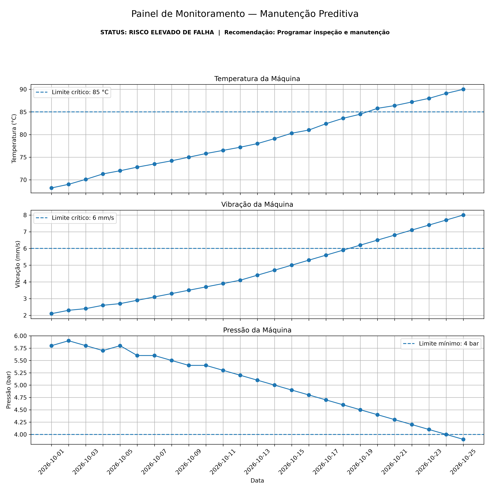

# Manutenção Preditiva com Python

Projeto de análise de dados aplicado à **Engenharia Mecânica**, desenvolvido para simular o monitoramento das condições operacionais de uma máquina e identificar sinais de possível falha antes de uma parada crítica.


O projeto utiliza dados simulados de sensores para acompanhar **temperatura, vibração e pressão**, gerar visualizações e emitir automaticamente um diagnóstico de risco.

## Objetivo

Demonstrar como Python e análise de dados podem ser utilizados em um cenário de **manutenção preditiva**, transformando medições de sensores em informações úteis para apoiar decisões de manutenção.

O sistema busca identificar alterações progressivas nos parâmetros operacionais da máquina e gerar um alerta quando os indicadores sugerem uma condição anormal.

## Variáveis monitoradas

- Temperatura da máquina
- Vibração da máquina
- Pressão da máquina
- Evolução dos indicadores ao longo do tempo

## Diagnóstico automático

Além da visualização dos dados, o código analisa o comportamento dos indicadores.

No cenário simulado utilizado neste projeto foram identificados:

- aumento da vibração;
- redução da pressão;
- alteração gradual das condições operacionais.

Resultado apresentado pelo sistema:

**STATUS: RISCO ELEVADO DE FALHA**

**Recomendação: programar inspeção e manutenção.**

## Tecnologias utilizadas

- Python
- Pandas
- NumPy
- Matplotlib
- Visual Studio Code

## Funcionamento

O fluxo do projeto é:

1. Geração/carregamento dos dados dos sensores.
2. Organização dos dados com Pandas.
3. Análise da evolução das variáveis.
4. Comparação dos indicadores ao longo do período.
5. Aplicação das regras de diagnóstico.
6. Identificação do nível de risco.
7. Geração automática do painel de monitoramento.
8. Exportação do resultado em imagem.

## Painel de monitoramento

O projeto gera automaticamente o arquivo:

`painel_manutencao_preditiva.png`

O painel apresenta três gráficos:

- Temperatura da Máquina
- Vibração da Máquina
- Pressão da Máquina

Também apresenta diretamente no painel o diagnóstico calculado pelo programa, facilitando a interpretação dos resultados.

## Estrutura do projeto

```text
manutencao_preditiva/
│
├── analise_manutencao.py
├── painel_manutencao_preditiva.png
└── README.md
```

## Como executar

Com Python instalado, instale as bibliotecas necessárias:

```bash
pip install pandas numpy matplotlib
```

Depois execute:

```bash
python analise_manutencao.py
```

O programa realizará a análise, exibirá o diagnóstico no terminal e abrirá o painel gráfico.

## Aplicação na Engenharia

Em um ambiente industrial real, um projeto desse tipo poderia receber dados provenientes de sensores instalados em motores, bombas, rolamentos, compressores ou outros equipamentos.

Com dados históricos suficientes, o projeto poderia evoluir para modelos mais avançados capazes de:

- detectar anomalias automaticamente;
- calcular indicadores de condição;
- acompanhar tendências de degradação;
- estimar probabilidade de falha;
- auxiliar no planejamento de manutenção;
- reduzir paradas não programadas.

## Próximas evoluções

Como continuidade, o projeto pode receber:

- dados reais provenientes de sensores;
- banco de dados para armazenamento histórico;
- dashboard interativo;
- limites operacionais configuráveis;
- análise estatística;
- detecção automática de anomalias;
- modelos de Machine Learning;
- integração com ESP32 ou sistemas IoT.

## Sobre o projeto

Este projeto foi desenvolvido como parte do meu portfólio, integrando conceitos de **Engenharia Mecânica, Python e Análise de Dados**.

O objetivo é demonstrar, de forma prática, como dados podem ser utilizados para apoiar decisões relacionadas à confiabilidade e manutenção de equipamentos.